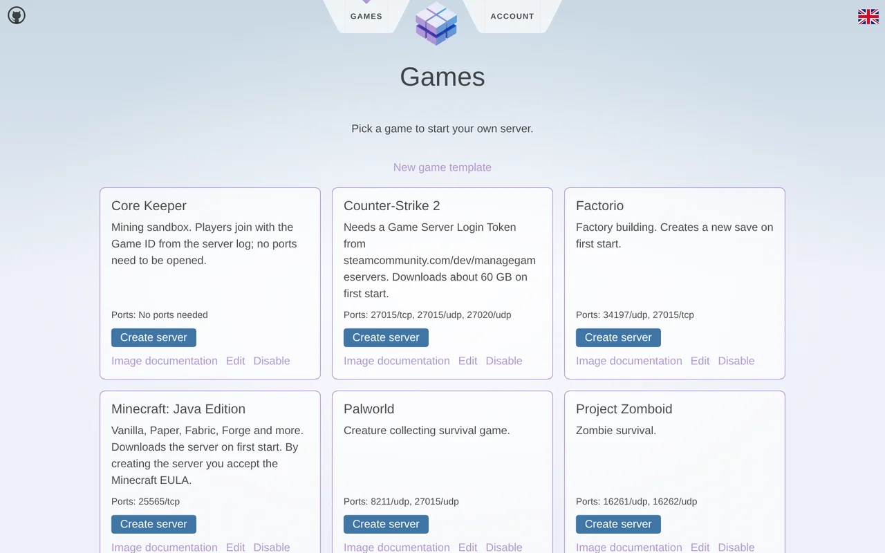
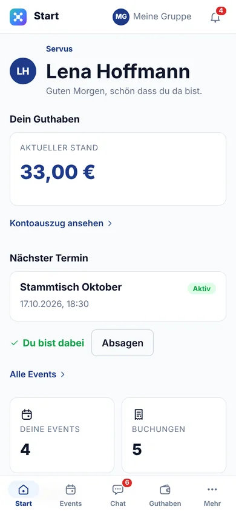
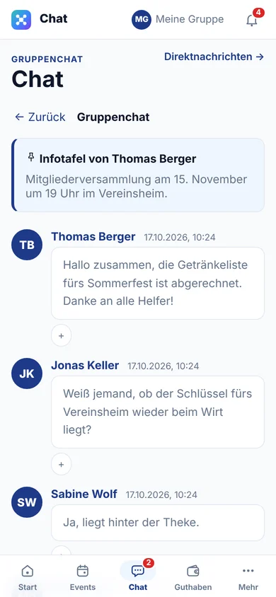
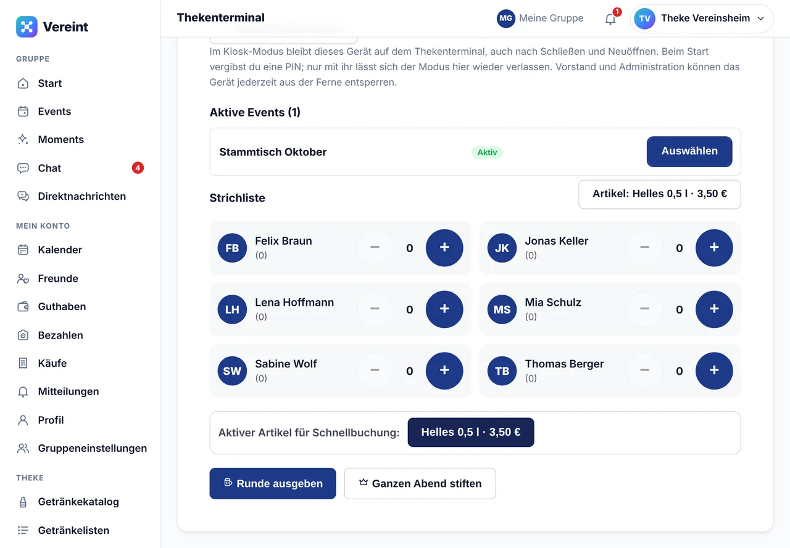

<h1 align="center">Servus, ich bin Michael! 👋</h1>

  <em>Softwareentwickler, Pixel-Prügler, Hantel-Stemmer und Sammler von Seitenprojekten.</em> 
  <em>Mein Motto: „Läuft lokal? Dann läuft's.“</em>

> [!NOTE]
> 🤖 **Transparenzhinweis:** Dieses Profil wurde von einer KI geschrieben. Ich habe ihr gesagt, sie soll mich vorstellen, und sie hat sich sofort ehrfürchtig durch meine Repos gelesen. Jede Übertreibung hier ist also ein Halluzinationsproblem, nicht mein Ego. Ich hätte es natürlich auch selbst schreiben können. Ich hatte nur gerade ein Wochenendprojekt.

---

## 🎤 Kurz zu mir

> **Name:** Michael Maurer (hier: [@damaurer](https://github.com/damaurer)) 
> **Wohnort:** irgendwo zwischen IDE und Terminal 
> **Lieblingssprache:** TypeScript, mit Affären zu Kotlin, Go und Java 
> **Superkraft:** aus „Ach, das bau ich mal eben am Wochenende“ ein echtes Projekt machen 
> **Schwäche:** „mal eben am Wochenende“ dauert selten nur ein Wochenende 
> **Fun Fact:** In meinem Prügelspiel ist der Endboss eine Tomate. Mit Umhang.

Genug von mir, hier sind die Projekte, an denen ich (gelegentlich mit KI-Kollegen) gebaut habe:

---

## 🥊 Projekt Nr. 1: SouthBeat

**[SouthBeat](https://github.com/damaurer/SouthBeat)** ist ein 2D-Pixel-Art-Beat-'em-up im Browser, in dem sich **Programmierer im Büro verprügeln**. Ehrlich gesagt die logische Konsequenz aus zu vielen Merge-Konflikten.

  

- 🧑‍💻 **Charakter-Editor:** Frisur, Bart, Outfit (vom Hoodie bis zur Rüstung) und Moves wie Tastatur-Jab oder Kaffee-Wurf
- 🏢 **10 Arenen:** vom Bunker-Office über den Serverraum bis zur Teeküche
- 🍅 **Einzelspieler-Leiter:** von Bernd Brummer bis zum gefürchteten Endboss **Darth Tomater**
- 🌐 **Online-Kampf:** Echtzeit-Duelle und Koop-Stage-Modus über WebSockets, der Server rechnet, damit keiner schummelt
- 🤖 **Content-Studio:** Du beschreibst in Worten einen neuen Gegner, eine KI baut daraus ein Inhaltspaket und prüft es gegen die Balance-Regeln

`Angular` · `SSR` · `TypeScript` · `WebSockets` · `Docker` · `Playwright`

---

## 🏋️ Projekt Nr. 2: LOCALlift

**[LOCALlift](https://github.com/damaurer/localift)** ist eine Trainings-App für alle, die lieber Gewichte heben als Datenschutzerklärungen lesen. Komplett offline, ohne Account, ohne Cloud. Deine Daten bleiben da, wo deine Hanteln auch sind: bei dir.

- 📋 Trainingspläne erstellen, Sätze und Gewichte live erfassen
- ⏱️ Automatischer Pausen-Timer, damit die Pause nicht zur Kaffeepause wird
- 🔥 Streak-Zähler und Wochenübersicht für das gute Gewissen
- 🧠 Ein KI-Assistent, der **direkt im Browser** läuft und beim Planen hilft, ganz ohne Server
- 📱 Installierbar als Progressive Web App

  

`React` · `TypeScript` · `Vite` · `Tailwind CSS` · `PWA` · `wllama`

---

## 🎮 Projekt Nr. 3: PocketDimension

**PocketDimension** *(privat, noch in der Werkstatt)* ist mein selbst gehostetes Kontrollzentrum für Gameserver. Statt mich nachts per SSH auf einen Server zu schleichen, weil jemand „nur kurz Minecraft“ spielen will, klickt man hier auf einen Knopf und bekommt einen eigenen Server als Docker-Container.

  

- 🕹️ **Spielekatalog:** Minecraft, Valheim, Terraria, Factorio, Counter-Strike 2, Palworld, Satisfactory, Rust, Core Keeper und Project Zomboid
- 🧩 **Eigene Spiele:** Alles, was in Docker läuft, kommt per Vorlage dazu (Image, Ports, Datenordner, Variablen)
- 📊 **Live-Status:** CPU, RAM, verbundene Spieler, Karte und Version jedes Servers
- 🔀 **Port-Jonglage:** Der zweite Minecraft-Server bekommt automatisch andere Ports, damit sich niemand in die Quere kommt

`SvelteKit` · `TypeScript` · `Docker` · `SQLite` · `GameDig`

---

## 🍻 Projekt Nr. 4: Vereint

**Vereint** *(privat, noch in der Werkstatt)* ist die App für Gruppen aller Art, vom Stammtisch über den Verein bis zum Team. Endlich keine Strichliste mehr auf dem Bierdeckel und keine Diskussion, wer die letzte Runde bezahlt hat.

  
  &nbsp;&nbsp;
  

  

- 📅 **Treffen und Events** mit Zu- und Absagen
- 💬 **Gruppen-, Direkt- und Event-Chats**, die Nachrichten landen verschlüsselt auf dem Server (AES-256-GCM, weil Stammtischgeheimnisse heilig sind)
- 💶 **Guthaben statt Bargeld** und Bezahlen per Barcode-Scan
- 🍺 **Thekenterminal** im Kiosk-Modus mit digitaler Strichliste und dem Knopf „Ganzen Abend stiften“
- 📸 **Moments** mit Fotos und kurzen Videos, dazu Statistiken und Einladungen per Link
- 📱 Installierbar als Web-App mit Push-Mitteilungen

`Kotlin` · `Spring Boot` · `Angular SSR` · `Keycloak` · `PostgreSQL` · `AWS`

---

## 🔒 Und in der geheimen Werkstatt …

… brodeln noch einige private Projekte vor sich hin: KI-Assistenten, Server-Setups und das eine oder andere Spiel. Manche davon kommen irgendwann ans Licht, andere bleiben für immer „fast fertig“. Wie das halt so ist.

---

## 🧰 Mein Werkzeugkasten

  
  
  
  
  
  
  
  
  

---

## 🎲 Zum Schluss

- 🕹️ Lust auf eine Runde SouthBeat? Gegen Darth Tomater hast du sowieso keine Chance.
- 🐛 Bug gefunden? Issue auf! Ich freue mich (meistens).
- ⭐ Ein Stern hier und da macht mich glücklicher als ein grüner CI-Build. Fast.

<em>Dieses README wurde mit viel Liebe und null eigenen Tastenanschlägen erstellt. 🤖✍️</em>

